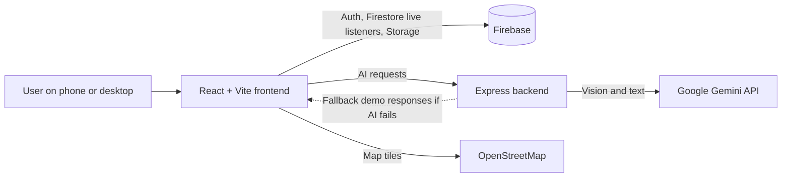

# Re:form 🌿🤍

**Give scraps a new form.**

> Millions of creative materials are thrown away before they ever become art.

Re:form is a GenAI-powered platform that connects discarded materials from fashion studios, print shops, photography studios and craft workshops with independent artists, then turns a pile of leftovers into a creative challenge.

Built for the **GeNarrative Clash Hackathon, Open Track** (GenAI that supports creative artists).

---

## Table of Contents

- [The Problem](#the-problem)
- [The Solution](#the-solution)
- [Key Features](#key-features)
- [How It Works](#how-it-works)
- [Architecture](#architecture)
- [Tech Stack](#tech-stack)
- [Project Structure](#project-structure)
- [Getting Started](#getting-started)
- [Firebase Setup](#firebase-setup)
- [Deploy to Vercel](#deploy-to-vercel)
- [Environmental Impact Method](#environmental-impact-method)
- [Security and Reliability](#security-and-reliability)
- [Live Demo Script](#live-demo-script)
- [Limitations](#limitations)
- [Roadmap](#roadmap)
- [License](#license)

---

## The Problem

Creative businesses throw away usable fabric offcuts, misprints, broken props and surplus stock every day, and most of it ends in landfill or incineration. At the same time, students and independent artists struggle to afford materials, and a random pile of leftovers feels too confusing to use. The materials exist. The connection, and the idea for what to make, do not.

## The Solution

Re:form lets suppliers list discarded materials in seconds, helps creators find the nearest supplier, and uses AI to give every creator a **Material-to-Art Challenge**: a random combination of real, available materials with a creative brief to make something from them.

**Our principle:** GenAI should not replace the artist. It removes the cost barrier and the creative block so artists can create more with less.

## Key Features

| Feature | What it does |
| :--- | :--- |
| **AI Material Scanner** | Upload a photo of scraps. Gemini vision identifies the material type, colour and approximate quantity, and creates editable listings. |
| **Material-to-Art Challenge** (main feature) | A slot-reel spin draws 2 to 4 random materials. Gemini writes a unique brief with a creative constraint (for example, "no glue"), a difficulty level and steps. |
| **AI Idea Generator** | Suggests three craft concepts for any set of materials, with simple instructions. |
| **Supplier Map and Matching** | Leaflet and OpenStreetMap with Haversine distance ranking. An AI "Best Match" card explains why a supplier fits and gives pickup advice. |
| **Orders and Delivery Tracking** | Request materials for pickup or delivery and follow a live status timeline. Suppliers get a control desk to update order status. |
| **Re:form Assistant** | A chatbot that reads live app state to answer questions about orders, materials and suppliers, and offers buttons that jump to the right page. |
| **Impact Tracker** | Estimates waste diverted and CO2e avoided for every completed project, shown on a live dashboard. |
| **Gallery** | Finished artworks with AI-written stories and a link back to the materials they came from. |
| **Authentication** | Google and Email/Password sign-in with Creator or Supplier roles, plus a one-tap demo user. |

## How It Works

1. A supplier uploads a photo of unused materials, for example fabric, buttons and a broken wooden frame.
2. AI scans the photo and lists each material automatically.
3. A creator finds the nearest supplier on the map and requests the materials.
4. The order moves through a live status timeline until it is delivered or collected.
5. The creator spins a challenge and AI generates a brief using those materials.
6. The creator makes the artwork and uploads a photo of the result.
7. AI writes the artwork's story, and the dashboard updates the impact numbers.

## Architecture



**How the pieces fit**

- **Frontend (React + Vite):** all pages and UI. It talks to Firebase directly for authentication, data and live updates, and calls the backend only for AI features.
- **Backend (Express):** the only place that holds the Gemini API key. It validates requests, applies rate limits and timeouts, retries once on bad AI output, and returns realistic fallback responses when the AI is unavailable.
- **Firebase:** Authentication for sign-in, Firestore for materials, suppliers, orders, artworks, users and activity (with `onSnapshot` live updates), and Storage for images (with a base64 Firestore fallback).
- **Map:** Leaflet with OpenStreetMap tiles. It is free and needs no API key. Distances are calculated on the client with the Haversine formula.

## Tech Stack

- **Frontend:** React 18, Vite, React.lazy code splitting
- **Backend:** Node.js, Express
- **AI:** Google Gemini API (vision and text), called only from the backend
- **Database, storage and auth:** Firebase (Firestore, Storage, Authentication)
- **Map:** Leaflet and OpenStreetMap
- **Testing:** Puppeteer end-to-end suites
- **Hosting:** Vercel (static frontend plus one serverless API function)

## Project Structure

```
RE-FORM/
├── package.json              # Monorepo build, dev and test scripts
├── vercel.json               # Vercel routing and build config
├── firestore.rules           # Firestore security rules
├── storage.rules             # Cloud Storage security rules
├── .env.example              # Environment variable template
├── api/
│   └── index.js              # Vercel serverless entry for the Express API
├── backend/
│   ├── package.json          # Express server dependencies
│   └── server.js             # Express API: Gemini calls, rate limiting, fallbacks
├── frontend/
│   ├── index.html
│   ├── vite.config.js        # Code splitting and dev proxy to the API
│   └── src/
│       ├── main.jsx          # React root with ErrorBoundary
│       ├── App.jsx           # State coordinator and route protection
│       ├── firebase.js       # Auth, Firestore listeners, Storage with fallback
│       ├── index.css         # Design system
│       ├── constants/
│       │   ├── impactFactors.js   # Emission factors and impact formulas
│       │   ├── seedData.js        # Starter materials and artworks
│       │   ├── seedSuppliers.js   # 8 demo suppliers around Ranchi
│       │   └── seedCustomers.js   # Demo creator and supplier personas
│       ├── components/
│       │   ├── AuthModal.jsx      # Sign-in with role choice
│       │   ├── ChatAssistant.jsx  # Floating assistant with quick actions
│       │   ├── Navigation.jsx     # Sidebar and mobile bottom bar
│       │   └── Icons.jsx          # Inline SVG icons
│       ├── pages/
│       │   ├── Dashboard.jsx      # Live metrics, trend chart, recent activity
│       │   ├── ScanMaterials.jsx  # AI material scanner
│       │   ├── Challenge.jsx      # Spin reel, brief, completion and story
│       │   ├── Ideas.jsx          # Three AI craft ideas
│       │   ├── Map.jsx            # Nearest-supplier matching
│       │   ├── Orders.jsx         # Delivery timeline and supplier desk
│       │   ├── CustomerMaterials.jsx  # Material custody and allocation
│       │   └── Gallery.jsx        # Artworks with impact tags
│       └── utils/
│           ├── distance.js        # Haversine calculation
│           ├── imageCompressor.js # Client-side image compression (max 1024px)
│           └── storage.js         # In-memory and localStorage sync
└── test/
    ├── flows.test.js         # 8 end-to-end user journeys
    ├── auth.test.js          # Authentication and role protection
    └── e2e.test.js           # Responsive layout and accessibility checks
```

## Getting Started

### Prerequisites

- Node.js 18 or later
- npm 9 or later
- A free [Gemini API key](https://aistudio.google.com/app/apikey)
- A Firebase project (see [Firebase Setup](#firebase-setup))

### 1. Install

```bash
git clone https://github.com/npcenergydev/RE-FORM.git
cd RE-FORM
npm install
```

`npm install` also installs the backend and frontend dependencies through a postinstall script.

### 2. Configure environment variables

Copy `.env.example` and create two files. Never commit real keys.

**Root `.env` (backend):**

```env
PORT=3001
GEMINI_API_KEY=your_gemini_api_key_here
GEMINI_MODEL=gemini-3.5-flash-lite
FRONTEND_URL=http://localhost:5173
```

**`frontend/.env` (frontend):**

```env
VITE_FIREBASE_API_KEY=your_api_key
VITE_FIREBASE_AUTH_DOMAIN=your_project.firebaseapp.com
VITE_FIREBASE_PROJECT_ID=your_project_id
VITE_FIREBASE_STORAGE_BUCKET=your_project.firebasestorage.app
VITE_FIREBASE_MESSAGING_SENDER_ID=your_sender_id
VITE_FIREBASE_APP_ID=your_app_id
VITE_FIREBASE_MEASUREMENT_ID=your_measurement_id
```

If the Gemini key is missing or the quota runs out, the backend serves realistic demo fallbacks so the app keeps working. If the model name is rejected, check the available models in Google AI Studio and update `GEMINI_MODEL`.

### 3. Run

```bash
npm run dev
```

- Web app: http://localhost:5173
- Backend API: http://localhost:3001

### 4. Test

```bash
npm test                    # all suites
node test/flows.test.js     # 8 end-to-end user journeys
node test/auth.test.js      # authentication and role protection
node test/e2e.test.js       # responsive layout and accessibility
```

## Firebase Setup

In the [Firebase Console](https://console.firebase.google.com/):

1. **Firestore:** Build > Firestore Database > Create database. Then open the Rules tab, paste the contents of [`firestore.rules`](./firestore.rules) and publish.
2. **Storage:** Build > Storage > Get started. Paste the contents of [`storage.rules`](./storage.rules) and publish. Storage may require the Blaze plan on new projects. If it is unavailable, the app stores compressed base64 images in Firestore instead.
3. **Authentication:** Build > Authentication > Sign-in method. Enable **Email/Password** and **Google**.
4. **Web app config:** Project settings > Your apps > Web. Copy the config values into `frontend/.env`.

For a friction-free evaluation, the app includes a one-tap **Continue as Demo User** button that signs in as a prepared creator.

## Deploy to Vercel

The repo is configured for Vercel: the Vite build is served from the CDN and one serverless function in `api/index.js` handles all API routes.

1. Push the repo to GitHub.
2. In [Vercel](https://vercel.com), choose **Add New > Project** and import `RE-FORM`.
3. Set **Build Command** to `npm run build` and **Output Directory** to `frontend/dist`.
4. Add the environment variables below for Production, Preview and Development, then deploy.

| Key | Purpose |
| :--- | :--- |
| `GEMINI_API_KEY` | Google AI Studio key (server only) |
| `GEMINI_MODEL` | Gemini model name |
| `VITE_FIREBASE_API_KEY` | Firebase web API key |
| `VITE_FIREBASE_AUTH_DOMAIN` | Firebase auth domain |
| `VITE_FIREBASE_PROJECT_ID` | Firebase project ID |
| `VITE_FIREBASE_STORAGE_BUCKET` | Firebase storage bucket |
| `VITE_FIREBASE_MESSAGING_SENDER_ID` | Firebase messaging sender ID |
| `VITE_FIREBASE_APP_ID` | Firebase web app ID |
| `VITE_FIREBASE_MEASUREMENT_ID` | Firebase analytics ID |

Or deploy from the CLI with `npx vercel` (preview) and `npx vercel --prod` (production).

## Environmental Impact Method

Reusing a scrap avoids producing a replacement and keeps waste out of landfill and incineration. Impact is estimated with:

```
kg of material diverted x emission factor = estimated CO2e avoided
```

Factors live in [`frontend/src/constants/impactFactors.js`](./frontend/src/constants/impactFactors.js). Material weights detected by AI are approximations, so every figure in the app is labelled as an **estimate**. Before quoting these numbers publicly, verify each factor against a published source such as the UK government's DEFRA conversion factors.

## Security and Reliability

- **Key isolation:** `GEMINI_API_KEY` exists only on the backend and is never sent to the browser.
- **Hardening:** CORS limited to the frontend origin, 5 MB request body limit and sliding-window rate limiting.
- **Fail-safe AI:** every AI endpoint has a timeout (25 seconds), one automatic retry, strict JSON parsing and a demo fallback, so the UI never breaks if the AI is slow or unavailable.
- **Performance:** route-level lazy loading cut the initial bundle from about 1,258 kB to 126 kB.
- **Rules:** Firestore and Storage rules require sign-in for writes, limit uploads to images under 5 MB, and keep user profiles private to their owner. These are demo-grade. Before any real deployment, tighten them so that users can edit only their own records and only suppliers can update the status of orders addressed to them.

## Limitations

This is a hackathon prototype.

- Delivery tracking is **simulated**. No real courier is connected.
- AI-detected quantities, weights and impact figures are estimates.
- Supplier data is seeded for demonstration around Ranchi, India.
- Firestore rules are demo-grade (see [Security and Reliability](#security-and-reliability)).

## Roadmap

- Real courier and pickup scheduling integration
- Supplier impact scores and verified sustainability badges
- Leaderboards, badges and weekly themed challenges
- Style-based matching between suppliers and creators
- Technique mentoring with saved project history
- Stricter per-user security rules and verified supplier onboarding

## License

MIT License. Built for the GeNarrative Clash Hackathon.
